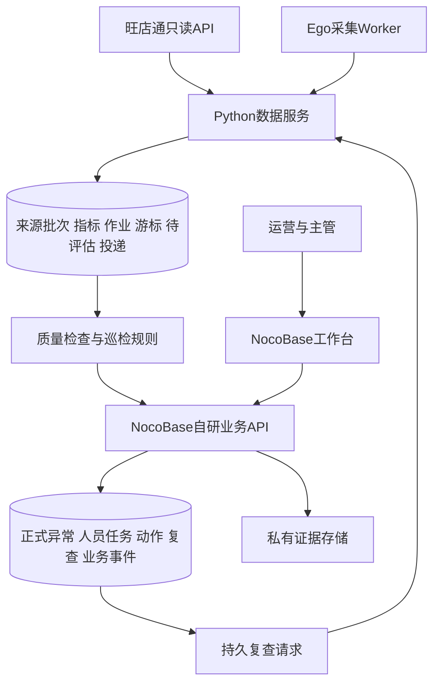

# 项目2 两店运营巡检与任务分发开发计划

> **For agentic workers:** REQUIRED SUB-SKILL: Use superpowers:subagent-driven-development or superpowers:executing-plans to implement this plan task-by-task. Steps use checkbox (`- [ ]`) syntax for tracking.

**Goal：**用 NocoBase 社区版、独立数据服务和 Ego Lite，在同一平台两家真实店铺跑通旺店通取数、规则巡检、人员派单、动作证据和效果复查。

**Architecture：**NocoBase 保存正式人员任务、权限与业务过程，Python 服务保存来源数据、指标、采集/评估作业和投递记录。两者通过版本化业务接口通信，Ego 是独立补采程序；首期规则和业务流程不依赖 AI 或 Vibe Seller 运行。

**Tech Stack：**NocoBase Community、TypeScript 业务插件、Python/FastAPI 数据服务、PostgreSQL、私有文件目录、Ego CLI、Docker Compose。具体兼容版本及镜像摘要在 T02 锁定；本计划不执行安装。

**Spec：**[既有架构评估](../../../项目2_NocoBase_旺店通_EgoLite_50店落地方案_2026-10-22.md)、[Vibe 源码评估](../../../项目2_VibeSeller深度评估与接入方案_2026-10-22.md)。本计划第1—8节为此次两店交付的范围约束，取代旧方案中更宽的首期范围和粗略日历排期。

## Global Constraints 全局约束

- 用户已选择 NocoBase＋独立数据服务＋Ego；不采购业务软件商业插件。现有旺店通、Ego、服务器和模型等费用另算，新增购买不包含在本计划授权内。
- 复用参考以稳定、便于维护、减少总开发量为标准；源码静态可读不代表已经通过稳定性测试。
- 首期同平台两家真实店铺；平台与具体店铺在 T01 根据授权和数据覆盖选择，不默认已经具备全部接口权限。
- 真实旺店通取数是验收前提。模拟数据、历史回放、人工文件导入分别标识，不能替代真实接口验收。
- 首期包含3条业务规则和数据质量检查；不自动改价、改广告、改库存、退款或向平台提交经营动作。
- 未经确认的规则只运行在 shadow 模式：记录评估但不自动派出经营任务。参数确认后创建不可变规则版本并启用。
- 数据缺失不写0；机器完成、人员动作完成、经营结果恢复分别记录。观察窗未到或数据不足不能当作效果已验证。
- 不修改 NocoBase 核心、不安装试用商业插件；复杂逻辑放版本管理的代码。业务关键字段禁止普通通用 CRUD 绕过状态转换接口。
- Vibe 首期仅作源码参考，不作为部署依赖；复制代码前记录固定提交、许可和修改来源。
- 本次交付是开发计划，本文提到的代码、目录、接口、测试和服务均为待开发项，不表示已经创建或通过验收。

## Review Focus 五类重点风险

1. 两店共仓、组合装和拆合单：库存不重复相加，订单不重复计数；T05/T06覆盖。
2. 数据导入后评估前崩溃、投递成功但回执丢失：不漏检、不重复派单；T05/T07/T10覆盖。
3. 任务由集成账号创建、用户越权下载附件或直接改状态：按业务范围鉴权，页面隐藏不能代替服务端检查；T03/T07/T10覆盖。
4. 退款迟到、数据更正、活动影响与观察窗未到：不产生确定性效果归因，不提前关闭；T06/T08覆盖。
5. Ego 错店、同 Profile 争用、旧 worker 迟到回传、重启漏窗：身份校验、租约校验和持久化补跑；T09/T10覆盖。

## 1 首期范围与交付物

首期按一个平台、两个店铺、一名主管及每店至少一位运营测试账号设计。优先选订单/退款可对账、能导出平台报表的两店；正式成员可一人兼任，但隔离测试必须使用不同账号。店铺完整数据量在 T01 记录，不用抽样数据冒充整店完整数据。

| 首期交付 | 边界 |
|---|---|
| 旺店通真实同步 | 店铺、商品/组合装、订单主子单、仓库库存、平台退款；ERP退货仅作关联/核对，避免重复累计 |
| 3条业务巡检 | 有效支付订单数下降、仓库/SKU低库存、店铺退款申请数量增加 |
| 数据质量检查 | 身份、分页/批次完整性、必需字段、来源状态映射、时区、数据新鲜度、样本量 |
| 人员派单 | 店铺负责人规则、缺负责人转主管待分配、共仓问题转库存负责人或主管；去重、改派、期限、逾期标识 |
| 动作与复查 | 运营提交处理说明与私有证据，主管验收动作，到期重新取数，恢复待确认、未恢复重开、数据不足继续观察 |
| Ego补采 | 同平台两店的一种整店报表；优先商品清单/商品表现。先手工导出对账，再自动下载，不以逐链接遍历作为默认方式 |
| 可恢复运行 | 持久作业、游标、待评估记录、双向投递收执、备份恢复与运行说明 |

本期不包含：转化率和利润完整口径、目标智能拆解、人员容量/依赖排程、新品7/14/21/28天管理、绩效评分、四平台50店推广、AI自动经营操作。这些保留为下一期，不因有相关开源代码就混入本期。

转化率待平台访客与订单分子同口径后开发。库存首期采用静态阈值；只有获得整个共享库存池的完整需求，才考虑覆盖天数。退款首期是“申请数量增加”，不将其包装成退款率。

## 2 配置与代码的分工

| 功能 | NocoBase配置 | 自研代码 | 首期验收 |
|---|---|---|---|
| 用户与角色 | 管理员、主管、运营、集成服务角色 | 自定义接口鉴权、店铺/仓库范围检查 | A店运营不能访问B店详情、导出和证据 |
| 店铺与人员 | 店铺、成员、负责人、时区、站点、仓库关系表与表单 | ERP ID/平台ID唯一约束、绑定版本校验 | 改名不影响关联，绑定冲突被拒绝 |
| 工作页面 | 我的任务、异常中心、数据健康、管理设置4个入口；任务详情内展示证据和复查 | 私有上传下载、关键操作按钮、必要的小区块 | 运营能从一条异常完成处理与复查查看 |
| 数据采集 | 接口连接名称、同步频率、采集状态展示；不显示密钥 | 旺店通签名、分页、限流、增量、回补、对账；Ego worker | 两店真实数据与原始来源对得上 |
| 巡检 | 规则参数表单、启停、主管确认 | 确定性规则、质量门禁、规则版本、异常合并 | 同一输入和规则版本得到同一结果 |
| 派单 | 店铺负责人、兜底主管、优先级和SLA配置 | 原子入库、去重、权限、状态机、改派、处理事件 | 重复推送不重复建任务 |
| 动作验收 | 说明表单、主管页面 | submit/accept/reject命令及权限、版本冲突检查 | 普通人员不能直接写“已关闭” |
| 效果复查 | 观察窗、恢复条件、最长观察配置 | 复查作业、固定基线、重新计算、重开/待关闭 | 缺数据或观察窗未到不能关闭 |
| 通知 | 站内工作台、逾期筛选 | 首期以待办为准；外部通知以后用自写适配器 | 无外部消息服务仍可完成流程 |
| 处理历史 | 事件时间线只读展示 | 事务内追加业务事件；普通账号禁止改删 | 改派、验收、重开、关闭都有操作者和理由 |
| 备份 | 备份周期、保留策略 | PostgreSQL与证据文件备份/恢复脚本 | 在独立测试环境恢复并对账 |

配置是开发工作的一部分，也需要验收与版本留档。店铺范围按成员/负责人授权；NocoBase“自己的记录”默认创建者规则不能直接套到集成账号创建的任务。

## 3 零商业插件依赖及替代策略

当前是在设计阶段，没有需要搬走的已购插件数据。优先从第一版就使用社区能力和自研业务插件，避免先依赖收费能力再迁移。

| 可能涉及的商业能力 | 本方案替代 | 交付边界 |
|---|---|---|
| 外部REST数据源、高级Webhook触发 | Python连接器＋受控集成API | 普通API交互，不使用商业数据源插件 |
| 专用审批 | 自研动作验收状态机、角色检查、版本控制、操作事件 | 本期覆盖处理验收；目标计划审批下一期复用机制 |
| 记录历史、全局审计 | 自研追加式业务事件表，普通账号禁止改删 | 覆盖本系统业务命令，不宣称覆盖所有数据库管理员操作或具备防篡改审计认证 |
| 私有文件高级存储插件 | 非公开本地证据目录＋鉴权上传下载接口 | 文件不进入公开静态目录；以后可换开源存储适配器 |
| 高级调度、事务可视化节点 | PostgreSQL作业账本、租约、代码事务和可靠投递 | 不用可视化节点承担跨服务事务 |
| 高级备份 | 数据库与文件备份脚本、恢复演练 | 不是仅检查“有备份文件” |
| 企业SSO、企业IM组织同步 | 首期本地账号与手工成员管理 | 确有需要时另开发标准协议适配器，不在首期复制整套企业身份产品 |
| AI/RAG商业插件 | 后续自写模型接口；首期普通SOP/文本记录 | AI不可用不影响本期闭环 |

官方当前标明基础人工节点与HTTP节点为社区版起，专用审批与记录历史为专业版起；本方案仍将关键状态变更写为自研服务端命令，避免把人工节点当完整业务任务。[人工节点](https://docs.nocobase.com/plugins/@nocobase/plugin-workflow-manual/)、[HTTP节点](https://docs.nocobase.com/plugins/@nocobase/plugin-workflow-request/)、[审批](https://docs.nocobase.com/plugins/@nocobase/plugin-workflow-approval/)、[记录历史](https://docs.nocobase.com/plugins/@nocobase/plugin-record-history/)。

执行要求：T02建立`docs/versions-and-licenses.md`，列出确切版本、许可证、社区插件允许清单、镜像摘要和依赖锁文件。部署校验发现商业/试用插件依赖则失败；不把停用的试用许可当作免费方案。自研模块不收商业插件授权费，但开发维护时间计入估工。

若以后某项需求只能靠收费插件实现：先定位该业务功能，新增相同领域接口的自研实现，暂停相应状态写入，导出稳定ID/状态/负责人/期限/事件/附件哈希，导入核对后切换；保留可恢复备份并只保留一个权威写入口。旧回调按命令ID去重。不会因此自动迁走全部NocoBase页面；若未来整体改为自写前端，页面配置和部分权限仍需重建，不能承诺零成本迁移。

## 4 系统与数据所有权



| 权威位置 | 数据 | 不允许的做法 |
|---|---|---|
| NocoBase应用库 | 店铺主档、成员与负责人、规则已批准版本、异常、正式人员任务、处理记录、复查要求、业务事件、接口收执 | Python直接改NocoBase内部工作流/系统表；两套服务各自推进人员状态 |
| 数据服务库 | 连接凭据引用、源对象、同步范围、批次、游标、标准化事实、规则版本副本、评估结果、采集/复查作业、outbox/inbox | AI随意改事实；把缓存规则副本当另一套可编辑主规则 |
| 私有目录 | 原始文件及业务证据；分别由拥有该目录的服务管理 | 公开静态URL、未经店铺/任务鉴权的下载 |

初期可共用一台PostgreSQL服务，但使用不同逻辑库和账号；两个应用不能互读对方底层表。人员页面只访问NocoBase，集成账号只能访问列明的接口。配置变更用版本化快照同步到数据服务，采集不得使用未识别的新绑定版本。

规则由NocoBase的主管确认入口发布；数据服务按版本执行。采集周期、业务期限、复查窗口按店铺IANA时区计算，内部时间统一保存UTC，保留业务日期和时区。

## 5 数据模型与接口合约

### 最小模型

| 模块 | 实体及关键约束 |
|---|---|
| 业务身份 | `Store`、`StoreMembership`、`WarehouseScope`、`OwnerAssignment`；连接ID＋ERP店铺ID唯一，库存按仓库/SKU定位 |
| 规则 | `RuleVersion`：规则族、指标版本、参数、作用域、观察/恢复条件、批准人、版本、shadow/enabled/retired |
| 异常 | `Incident`、`Occurrence`：连续同类问题只有一个未关闭事件；评估版本变化保留新证据，不自动新开一张工单 |
| 人员 | `OpsTask`、`ActionAttempt`：唯一业务ID、来源、负责人、期限、状态、乐观锁版本；每次处理独立记录 |
| 复查 | `EffectReview`：动作ID、指标/规则版本、固定基线、观察窗、数据要求、结果、主管最终结论 |
| 证据与事件 | `Evidence`、`BusinessEvent`：哈希、受控存储键、关联范围、操作者、原因、服务端时间；更正追加记录 |
| 数据 | `CollectionJob`、`Batch`、`SourceObject`、`Cursor`、`MetricFact`、`PendingEvaluation`、`Evaluation`；NocoBase保存只读`DataHealth`投影和可处理`DataIssue` |
| 可靠协同 | 两边各自的`Outbox`、`InboxReceipt`；数据服务的`JobAttempt`、`Lease`，不以进程内队列作为唯一记录 |

库存任务首期默认主管/库存负责人可见和处理，避免将共仓明细泄露给无仓库权限的运营。一个共仓SKU短缺只建一张任务，受影响店铺作为关联资料；店铺运营的可见摘要在需要时另做字段过滤。

### 接口与内部类型

以下是拟开发API，尚不存在。协议定义在`contracts/ops-v1.schema.json`、`contracts/openapi.yaml`，Python与TypeScript共享同一份JSON Schema。

统一命令包含`schema_version="1"`、`command_id`、`payload_hash`、`binding_version`、`occurred_at`和具体payload。服务端检查身份、允许范围、唯一命令ID及内容哈希；相同ID不同内容返回409。所有状态变更带`expected_version`，并发过期返回409。

| 接口 | 调用者→提供者 | 约束 |
|---|---|---|
| `GET /api/opsConfig:snapshot` | 数据服务→NocoBase | 返回已批准绑定、负责人、规则和配置版本；不含普通用户无权读取的密钥 |
| `POST /api/opsRule:command` | 主管→NocoBase | publish/enable/retire，检查参数、作用域和expected_version；草稿可配置，已发布内容不可原地修改 |
| `POST /api/opsDataHealth:ingest` | 数据服务→NocoBase | 同步`HealthEnvelope`，按scope＋data_type＋health_revision更新只读摘要，合并数据问题；没有成功批次也必须上报 |
| `POST /api/opsInspection:ingest` | 数据服务→NocoBase | 消费`EvaluationEnvelope`，短事务写收执、异常/观察、必要任务及事件；重复返回原ID |
| `POST /api/opsTask:command` | 人员→NocoBase | `TaskCommand`：claim/start/submit/accept/reject/reassign/block/resume/confirm_close/cancel；逐条验证角色和状态 |
| `POST /api/opsEvidence:upload`、`GET /api/opsEvidence:download?filterByTk=ID` | 人员或集成服务→NocoBase | 任务/范围鉴权后上传、下载；证据存私有目录，禁止通过猜路径绕过 |
| `POST /v1/review-requests` | NocoBase→数据服务 | 幂等接收`ReviewRequest`并持久化后返回202和receipt_id；202不等于复查完成 |
| `POST /api/opsReview:ingest` | 数据服务→NocoBase | `ReviewResult`，检查review_id、attempt_version、窗口、口径、数据完整性后更新 |
| `POST /v1/worker/jobs:claim`、`POST /v1/worker/jobs/{id}:heartbeat` | Ego worker→数据服务 | worker凭据、授权绑定、租约和Profile互斥；返回明确操作范围 |
| `POST /v1/worker/batches:commit` | Ego worker→数据服务 | 原始文件、哈希、观测身份、窗口、必需字段、覆盖范围、尝试和租约版本 |

`EvaluationEnvelope`含`evaluation_id/batch_id/rule_version/metric_version/scope/incident_fingerprint/evaluation_window_end/metric_revision/outcome/evidence_refs`，outcome为normal/abnormal/insufficient。`ReviewRequest/ReviewResult`均带`review_id/action_attempt_id/review_generation/attempt_version`；结果为recovered/not_recovered/insufficient，附实际数据窗和证据。采集状态succeeded/partial/needs_user/failed，与上述业务结论分开。

`HealthEnvelope`含`scope/data_type/health_revision/last_attempt_at/last_success_at/expected_window/freshness_deadline/status/missing_fields/error_class`。health_revision在数据服务内按范围单调递增，旧摘要不能覆盖新摘要。DataIssue按范围和问题类别合并，指派数据维护人或兜底主管；健康恢复后标记recovered并等待确认，不改动经营任务的复查状态。

### 恢复与一致性

1. 原始大批次可分块暂存；只有全部分页及校验通过，才在短事务中将批次标为成功、推进水位并创建待评估记录。部分暂存数据不进入完整指标。
2. 评估成功时，评估结果与待投递outbox同事务写入。NocoBase写入收执、异常、任务和事件也在同一事务中完成。
3. 人员动作验收后，NocoBase同事务创建复查要求和出站投递记录。数据服务持久接收后回应；结果同样可靠回传，直至对方收执持久化。
4. 原始事实、规则版本、评估ID和事故合并键各有用途，不混用一个“去重ID”。同一持续异常每日补充观察，不每天派新单。
5. 采集、评估、复查作业按应执行窗口留账，重启扫描未完成项。租约过期可重领，旧attempt或旧租约结果不能覆盖新结果。
6. 网络HTTP只保证重试投递；通过数据库唯一约束和事务保证业务效果不重复，不宣称跨服务存在一个总事务。
7. 新鲜度扫描独立于成功批次运行：按应执行窗口和最后成功时间检查，首次失败、持续无成功批次、Ego needs_user也产生健康摘要和DataIssue。不能只在数据到齐时检查是否缺数据。
8. NocoBase按scope＋规则族保存最新已应用业务窗口和修订号。同窗口取较新修订，旧窗口或已失效规则结果仅补历史，不自动新建或重开工单；历史更正影响已关闭结论时标记主管待复核。正常巡检结果不能代替正式效果复查关闭任务。
9. 取消任务、作废动作或重设复查时，权威端使旧review_generation失效。迟到结果仍保存收执和忽略原因，但不得改变cancelled/closed任务或覆盖当前复查。新发生异常须来自当前有效规则、更新窗口，并建立关联历史的新事件。

## 6 首批规则与状态

### 规则定义

下表数值仅用于开发夹具和shadow初始建议。T01记录运营确认，未批准版本不得自动派出经营任务。参数可以改，改后形成新版本。

| 编号 | 判断 | 开发夹具/初始建议 | 复查依据 |
|---|---|---|---|
| R1 店铺订单下降 | 同店最近7个完整业务日有效支付订单数，对比前7日；按平台订单ID去重，使用已确认的取消/退款排除口径 | 前期≥20单、下降≥30%、连续2个日评估；夹具前期30、近期14应命中，基准10为样本不足 | 固定基准与同口径7日观察窗；恢复阈值单独确认，活动变化作为限制记录 |
| R2 仓库SKU低库存 | 已确认的可用库存数量低于SKU阈值；共享仓去重 | 夹具阈值5、可用3命中，可用5不命中；两店共仓只产生一个异常 | 动作后按配置到期取新库存；建议连续2次达到恢复阈值，间隔由业务确认 |
| R3 店铺退款申请增加 | 最近7日去重退款申请数对比前7日；只算选定平台退款来源，ERP退货不再累加 | 最近≥5、增量≥3且倍率≥2；前期为0走绝对阈值分支，不做除0；这是数量而非退款率 | 固定前期基准与后续完整观察窗，保留退款滞后限制，不能直接归因于处理动作 |
| DQ 数据质量 | 数据过期、批次缺页、身份不符、未知枚举或字段/映射缺失 | 数据不足时R1/R2/R3为insufficient；合并产生数据处理待办，不制造经营异常 | 完整数据重新到齐后重算，记录修订版本 |

R1的规范化支付/取消状态及订单拆合映射必须由真实样本确认。若无法从ERP主子单重建稳定的平台订单口径，该规则保持shadow/不可判断，先修映射。不得用已发货单数暗中替代有效支付订单数。

工作日活动、异常促销和店铺停业可配置排除/观察标签；首期不训练预测模型。数据延迟宽限、采集频率、任务SLA及复查窗口在T01填入配置；测试分别验证参数生效，不把开发示例当生产承诺。

### 人员任务与复查状态

人员任务：`unassigned → todo → doing → submitted → awaiting_review → pending_close → closed`。

完整状态集合另含`blocked`、`reopened`、`cancelled`。reopened经start回到doing；blocked保存blocked_from，resume恢复该状态。前端标签与后端枚举使用同一契约，禁止另造同义状态。

- 无负责人进入unassigned并由主管处理；有效负责人可直接todo。
- submitted：主管reject返回doing，accept锁定本次动作证据并创建复查；运营不能自行accept。
- 复查not_recovered：任务reopened，重新处理后新建ActionAttempt，不覆盖旧证据。
- 复查insufficient：保留awaiting_review，复查状态waiting_data并记录补采任务；超最长观察时间转主管，不静默无限等待。
- 复查recovered：进入pending_close，主管确认后closed；经营恢复不等于已证明动作导致恢复。
- block/resume保留原状态和阻塞原因；cancel仅主管可执行并记录原因，同时使活动复查版本失效，取消与经营恢复分开统计。
- 关闭后同类问题再次发生，新建后续Incident并关联历史，不覆盖已结事件。

复查固定引用动作、指标版本、规则版本与基准期。规则随后修改，不悄悄改旧复查标准；需要重设时由主管创建新复查版本并保留原因。

## 7 文件与模块结构

当前工作目录只有研究资料，以下生产目录均待创建；不修改`research/`中的参考仓库。

```text
contracts/
  ops-v1.schema.json                 跨语言消息类型与校验
  openapi.yaml                      对外接口、错误、权限与幂等
  fixtures/                         脱敏正常/异常/重复/错店样本
services/ops-data/
  pyproject.toml
  src/ops_data/
    api/{health,review_requests,worker_jobs}.py
    connectors/wdt/{auth,client,pagination,orders,inventory,refunds}.py
    ingestion/{batches,cursors,normalization,reconciliation}.py
    metrics/{orders,inventory,refunds}.py
    rules/{engine,sales_drop,low_stock,refund_spike,quality}.py
    jobs/{ledger,leases,scheduler,health_scan}.py
    delivery/{outbox,nocobase_client}.py
    reviews/{service,evaluator}.py
  migrations/
  tests/{test_wdt,test_ingestion,test_rules,test_outbox,test_reviews,test_recovery}.py
nocobase/plugins/@project2/plugin-ops/
  src/server/
    collections/                    业务表及约束
    actions/{config,rules,data-health,inspection,tasks,evidence,reviews}.ts
    services/{scope,state-machine,incidents,events,outbox}.ts
    migrations/                     业务插件迁移
  src/client/                       操作按钮、私有证据区块
  src/__tests__/                    权限、事务、状态机、下载与收执测试
workers/ego/
  runner.mjs
  adapters/{identity,report-export}.mjs
  tests/                            使用受控页面夹具，不测试真实店铺写操作
deploy/{compose.yaml,env.example}
scripts/{backup,restore,verify-community,export-domain}.sh
tests/e2e/                          两店闭环与跨服务故障场景
docs/{versions-and-licenses,field-dictionary,rule-register,operations-runbook}.md
docs/nocobase-config/               表、角色、页面、动作配置清单与复现步骤
Makefile                            统一测试与验证入口
```

路径是模块划分建议。T02须依据所锁NocoBase版本的官方插件脚手架确定包内文件位置，并更新此映射；不能为了符合示意目录修改框架加载机制。

## 8 开发顺序与工时

估算假设：一位有Python/TypeScript基础的开发者，有运营对口人、可用服务器和接口权限；包含配置、代码、关键测试和交接，不包含等待授权、等待业务确认、平台故障和真实效果观察的日历时间。首次接触NocoBase或API样本不完整时需重估。

| 顺序 | 工作包 | 依赖 | 初估有效工时 |
|---|---|---|---:|
| T01 | 两店、样本、口径与规则确认 | 无 | 8—12小时 |
| T02 | 社区环境、版本、插件骨架与契约 | T01范围 | 8—12小时 |
| T03 | 业务表、页面、人员与范围权限 | T02 | 16—24小时 |
| T04 | 旺店通鉴权、分页、限流及真实请求 | T01、T02 | 12—18小时 |
| T05 | 事实标准化、回补增量、质量与对账 | T04 | 24—36小时 |
| T06 | 三规则、样本门槛及持续异常标识 | T03、T05 | 12—18小时 |
| T07 | 幂等派单、状态机、私有证据与事件 | T03、T06 | 20—28小时 |
| T08 | 到期复查、可靠回传、重开与关闭 | T05、T07 | 12—18小时 |
| T09 | 同平台Ego报表补采 | T02、T05；核心ERP链路可先完成 | 16—30小时 |
| T10 | 跨服务恢复、权限与备份恢复 | T07、T08、T09 | 14—22小时 |
| T11 | 两店真实试用与交接 | T10 | 12—20小时 |
| 合计 | 含Ego补采 |  | 154—238小时 |

核心ERP闭环不含自动Ego约138—208小时，即每天5小时约28—42个工作日。全计划加约20%不确定性缓冲，预算约190—290小时、38—58个工作日，约8—12个五天工作周；这不是固定交付承诺。T04取得真实样本后重新估算，不套用固定“AI提效倍数”。

阶段检查点：T03有可操作工作台但尚无真实巡检；T05有两店对账数据；T07可真实派单；T08核心复查闭环可验证；T09补齐Ego；T10后进入真实试用。历史回放能提前验证流程，真实观察窗口必须等到期。

## 9 可执行任务清单

每个代码任务先写所列关键回归用例，确认旧行为/未实现时失败，再实现、通过检查和代码审查后合入；纯配置不写镜像式单元测试，使用角色操作与API验收。下面的命令由T02的Makefile定义，当前不可视为已可运行。

### T01 两店与数据口径

**2026-10-22实施状态：partial。** 已准备资料/字段/规则模板；真实两店身份、授权与样本尚待核验，以下真实验收项保持未勾选。

**文件：**创建`docs/field-dictionary.md`、`docs/rule-register.md`、`contracts/fixtures/`中的脱敏样本。
**输入/输出：**读取需求和旺店通官方接口；输出两店绑定清单、字段映射、三规则确认表、负责人/SLA/观察窗、Ego报表选择。

- [ ] 选同平台两店，记录正式SID引用、ERP shopId、站点/时区/币种、仓库、负责人和API授权责任人；密钥走安全配置，不写文档。
- [ ] 收集订单拆合/取消/退款、共仓SKU及组合装样本；记录源字段→标准字段及枚举，不确定映射标为不允许启用的缺口。
- [ ] 明确R1订单口径、R2共享库存和负责人、R3数量口径；确认生产参数与复查窗口，未确认项以shadow状态保存。
- [ ] 验收：两店身份可由源数据核对；每个规则都有来源、计算、启用条件、负责人与恢复条件。无法取得真实授权时继续离线开发，真实接入里程碑保持未完成。

### T02 免费环境与契约

**2026-10-22实施状态：本地基础已交付。** 详见 [T01/T02交付记录](../../t01-t02-delivery.md)。真实经营端点仍pending；Ego/E2E和后续业务用例只有明确失败的预留入口，不冒充已实现测试。

**文件：**`deploy/`、`Makefile`、`contracts/ops-v1.schema.json`、`contracts/openapi.yaml`、`docs/versions-and-licenses.md`、`scripts/verify-community.sh`、两服务及插件测试骨架。
**接口：**输出上述第5节类型和统一错误：400结构错误、401未认证、403无范围、409命令/状态冲突；不同对象ID的不可见查询保持一致策略，避免泄露存在性。

- [x] 按官方稳定兼容组合锁定NocoBase、PostgreSQL、Python及Node版本、镜像digest和锁文件；不用`latest`，不启用商业试用。
- [x] 搭建两逻辑库、服务账号与私有目录；只有受控业务入口对人员开放，数据库/采集内部端点不公开。
- [x] 建立共享Schema和夹具，定义`make test-data`、`test-plugin`、`test-ego`、`test-e2e`、`verify-community`、`verify-contracts`入口，绑定实际测试工具。
- [x] 固定CASE映射：数据端`test_wdt/test_ingestion/test_rules/test_reviews/test_recovery`对应同名测试文件，`outbox`对应`test_outbox.py`；插件端`scope/tasks/evidence/reviews`对应同名`.test.ts`。未知CASE必须报错，避免“未执行任何测试”被当成通过。
- [x] 验证非法schema_version和相同command_id不同payload均被识别；`make verify-community verify-contracts`退出0才继续。
- [x] 提交版本清单和契约，检查两种语言对ID、时间、Decimal金额和可空字段解释一致。

### T03 业务模型、页面与权限

**文件：**插件`collections/`、`migrations/`、`services/scope.ts`、`src/__tests__/scope.test.ts`，`docs/nocobase-config/`。
**接口：**`assertScopeAccess(actor, scope, action): void`；`GET opsConfig:snapshot`提供版本化配置；`executeRuleCommand(command, actor) -> RuleVersionReceipt`提供主管发布入口。权限来源是成员/角色关系，不接受请求体自报角色。

- [ ] 编写用例：A店运营查询B店详情/API导出被拒绝；集成账号创建任务后A店运营仍能按负责人看到；共仓任务无仓库权限不可见。
- [ ] 创建领域表、稳定ID、业务唯一约束和配置迁移；配置4个入口及只读事件时间线。
- [ ] 配置角色与列表范围；关键状态、负责人、已批准规则、事件记录关闭普通写入，后续只能经自研动作修改。
- [ ] 实现规则publish/enable/retire命令：参数和作用域验证后，事务内写不可变规则版本、批准事件与配置版本。运营发布返回403；过期expected_version返回409；客户端旧快照不能回写覆盖新配置。
- [ ] 运行`make test-plugin CASE=scope`并用4类账号执行配置验收；保存可复现配置说明，而不只截屏。

### T04 旺店通连接器

**文件：**`connectors/wdt/{auth,client,pagination,orders,inventory,refunds}.py`、`tests/test_wdt.py`。
**接口：**`WdtClient.request(endpoint: str, payload: dict) -> dict`；各连接器输出原始页和范围，不直接创建任务。

- [ ] 使用官方完整鉴权样例核对签名字节与时间戳，不使用文档公开示例密钥；凭据仅服务端持有，日志脱敏。
- [ ] 写测试：签名golden fixture、时间重签、按SID＋URI共享限流、不同分页语义、接口业务错误不误判成功、限流退避及超时。
- [ ] 实现只读API允许清单；起步共享限速40次/分钟（工程值，低于文档每SID＋URI少于60次要求）。
- [ ] 用正式授权分别取得两店、订单/子单、库存、退款样本，核对状态参数；不能使用默认“只取已发货”替代已确认口径。
- [ ] `make test-data CASE=test_wdt`通过，保存脱敏请求/响应和对账摘要；真实接口未通过不得标记T04完成。

### T05 标准化与可靠同步

**文件：**`ingestion/`、`metrics/`、`jobs/{ledger,leases,health_scan}.py`、插件`actions/data-health.ts`、数据迁移、`tests/test_ingestion.py`。
**接口：**`commit_batch(batch_id: UUID) -> BatchReceipt`；`materialize_metrics(batch_id: UUID) -> MetricSnapshotRef`；成功批次触发持久`PendingEvaluation`。

- [ ] 写用例：重复页/文件不增计、平台订单拆合去重、订单状态更正、退款来源去重、组合装关联、共仓不乘店数、过期版本不覆盖新数据。
- [ ] 实现端点专用分页与游标；冻结查询结束时间、重叠回拉、稳定源ID upsert、历史回扫。增量库存同时间戳不能盲目加1跳页。
- [ ] 原始页暂存并记录覆盖；完整校验后才提交可用批次/水位/待评估。批次局部失败保持partial；已存在完整快照可供历史查看但标识时间，不冒充本轮数据。
- [ ] 写崩溃用例：成功标记与待评估同事务，断电重启后未评估批次仍可找到。
- [ ] 实现独立健康扫描与可靠摘要投递：首次失败、连续无成功批次、needs_user均能在NocoBase显示并合并数据待办；旧health_revision不覆盖新状态。扫描周期是工程配置，是否过期按端点时效要求判断。
- [ ] 历史回补至少覆盖R1/R3前后窗口及迟到回扫，默认目标28完整业务日；按接口窗口限制切片。抽查每店至少20笔订单、10条SKU、退款样本及日汇总；样本不足则全量核对并记录。
- [ ] `make test-data CASE=test_ingestion`通过，账目差异全部分类解释后才启用对应规则。

### T06 三规则与质量门禁

**文件：**`rules/`、`tests/test_rules.py`、`contracts/fixtures/rules/`。
**接口：**`evaluate_rule(snapshot: MetricSnapshotRef, rule: RuleVersion) -> EvaluationEnvelope`；无模型调用。

- [ ] 使用第6节确定夹具：R1前期30近期14连续两次命中，基准10 insufficient；R2库存3阈值5命中且共仓不重复；R3前期2近期6命中，前期0走绝对门槛。
- [ ] 写边界测试：正好阈值、样本不足、缺页、未知枚举、过期数据、活动排除、迟到更正；缺数据不等于normal。
- [ ] 实现规则版本、scope和incident_fingerprint；同一持续问题不因新日期或规则升版自动生成第二张未结任务。
- [ ] shadow运行真实两店数据，请运营确认命中/不命中/不可判断案例；批准后启用自动经营派单。
- [ ] `make test-data CASE=test_rules`通过；每个结论可追到指标窗口、原始批次、公式和规则版本。

### T07 派单、证据与业务事件

**文件：**插件`actions/{inspection,tasks,evidence}.ts`、`services/{incidents,state-machine,events}.ts`；数据服务`delivery/`；相应测试文件。
**接口：**`ingestInspection(envelope, actor) -> Receipt`；`executeTaskCommand(command, actor) -> TaskVersion`；`EvidenceRef={id,sha256,scope,media_type,bytes}`。

- [ ] 写事务测试：同评估投递10次只产生一次观察；连续异常多次评估只有一张未结任务；同命令不同内容409；回执丢失后重试返回原ID。
- [ ] 写乱序用例：新窗口已应用后旧异常首次到达，只补历史、不派第二张单；历史更正影响已关闭结论时进入主管待复核，不能静默覆盖终态。
- [ ] 实现按负责人派单、兜底主管、共仓单、优先级和期限；服务端验证指派人确有目标范围权限。
- [ ] 实现第6节状态机，submit必须有说明及规则要求的证据；accept/reject/reassign/cancel记录理由与事件，版本过期409。
- [ ] 实现私有证据上传下载：首期允许PNG/JPEG/PDF/CSV/XLSX，单文件20MiB（工程初值）；校验类型和大小，文件名不能变路径，未经授权拿到ID仍不可下载。不启用商业私有文件插件。
- [ ] 文件完整写入、计算哈希后才创建可用Evidence记录；上传中断不留下“有效证据”。业务事件、任务状态变更同事务提交。
- [ ] 运行`make test-plugin CASE=tasks`、`CASE=evidence`及`make test-data CASE=outbox`；配置按钮并实际走完A店运营提交/B店越权/主管验收。

### T08 效果复查

**文件：**插件`actions/reviews.ts`、`services/outbox.ts`；数据服务`api/review_requests.py`、`reviews/`、`tests/test_reviews.py`。
**接口：**`accept_review_request(request: ReviewRequest) -> Receipt`；`evaluate_review(request, snapshot) -> ReviewResult`；`ingestReview(result, actor) -> Receipt`。

- [ ] 写用例：动作验收和复查请求同事务；未到观察窗不能提前下结论；重复投递不重复建复查；旧尝试结果不能覆盖新结果。
- [ ] 验证任务取消/复查重设后的旧结果：保存幂等收执并标记ignored_superseded，不改变任务终态或当前review_generation；重复忽略也不产生重复事件。
- [ ] 实现固定基线与版本、到期新数据请求、完整性检查、recovered/not_recovered/insufficient三分支。
- [ ] recovered只到pending_close；主管确认才关闭。未恢复重开并保留历史；缺数据安排补采，超过观察上限进入主管待决。
- [ ] 实现回传outbox和收执，不依赖一次HTTP或SSE；断线恢复后继续投递。
- [ ] `make test-data CASE=test_reviews`、`make test-plugin CASE=reviews`通过。用历史回放演示三分支并标识回放，真实复查保留实际到期时间。

### T09 Ego同平台报表

**文件：**`workers/ego/`、数据服务`api/worker_jobs.py`及worker合约测试；增加报表标准化映射。
**接口：**使用第5节claim/heartbeat/commit；`collectReport(job) -> BatchEnvelope`，批次含观测店铺ID/站点、窗口、必需字段、文件哈希及lease/attempt版本。

- [ ] T01选定报表先由授权人员手工导出并对账，再固定对应页面流程和字段；文档化绑定ID与Profile引用，不按当前活跃标签页猜店铺。
- [ ] 写受控页面测试：错店/错站点立即失败、日期窗不符拒绝、同Profile只能一个有效租约、需要登录转needs_user、旧租约回传拒绝。
- [ ] 按执行时安装版Ego官方skill实现采集；每个作业遵守TaskSpace生命周期，保存下载到持久目录再提交。发生用户接管时停止该作业的自动控制。
- [ ] 租约失效立即停止旧worker的浏览器操作；确认旧执行已停止后才能向同Profile派新作业。无法确认时转needs_user，不能仅因数据库租约到期就并行操作同一会话。
- [ ] 将两店同一报表接入通用Batch校验，人工导入与自动采集保留不同来源标记。完整商品清单成功前不因缺席推断下架。
- [ ] `make test-ego`通过；实际两店各完成一次授权只读导出，并演示一次登录失效恢复。Ego失败不阻塞已完整的ERP规则运行。

### T10 恢复、权限与备份

**文件：**`tests/e2e/`、`tests/test_recovery.py`、`scripts/{backup,restore,verify-community,export-domain}.sh`、`docs/operations-runbook.md`。
**接口：**`export-domain`导出版本化业务JSONL、ID关系、事件及证据清单/哈希；用于备份核对和以后替换模块，不导出明文密钥。

- [ ] 依次注入批次提交前/后、评估前/后、NocoBase写入后回执前、复查结果回传前崩溃，以及旧评估乱序和取消后迟到结果；验证恢复后不漏单、不重单、不改变已失效流程。
- [ ] 停机跨过采集/复查触发点后重启，作业账本找回漏窗；任务阻塞和失败店铺在数据健康页可见。
- [ ] 用不同角色测试列表、详情、导出、状态命令、规则发布、证据链接；直接调用CRUD或猜ID不能绕过权限。
- [ ] 执行`make verify-community test-e2e`，完全没有商业插件时走通核心流程；关闭模型接口仍能完成流程。
- [ ] 执行备份并恢复到隔离测试环境，核对任务状态、权限、事件、游标和证据哈希；恢复备份时记录暂停/恢复调度与作业对账步骤。
- [ ] 密钥和部署配置使用独立受控备份/恢复步骤，禁止混入领域导出或Git。数据库、文件与配置恢复到同一可核对时点，验证恢复后的接口连接和证据访问。
- [ ] 记录两店实际全量同步时间、接口调用量、积压和人工新增任务量，不从两店结果直接承诺50店容量。

### T11 真实试用与交接

**文件：**`docs/pilot-acceptance.md`、`docs/operations-runbook.md`、业务配置确认记录。
**交付：**可运行的两店系统、版本/配置/代码、实际验证证据、故障与恢复说明、下一期范围。

- [ ] 两店连续5个工作日试用，运营记录任务是否真实、重复、可处理、证据要求是否明确；主管检查待分配、逾期和复查队列。
- [ ] 测试集至少覆盖20个规则/数据异常案例和10个完整任务流程，可用构造和回放；真实接口、真实人员操作、真实观察结果分别列证据，不混算。
- [ ] 两店分别提供取数批次→评估→派单→人员提交→主管验收→复查回执的关联证据。某店无真实异常时使用明确标识的测试任务验证链路，不修改生产规则制造异常；验收分开记录技术链路通过与真实业务观察完成。
- [ ] 至少一项到期真实复查完成取数和判断；结果可以是未恢复或数据不足，但真实效果“已恢复”必须有完整观察数据和主管确认。其他未到期复查继续保留，不为交付缩短窗口。
- [ ] 阻断使用、串店、越权、重复任务、静默漏检问题解决后交付；待办列出负责人和影响。培训一次登录失效、重试、改派、数据不足和恢复流程。
- [ ] 根据实际工时、API覆盖和报表稳定性重新估算5—10店扩展，不自动进入四平台50店实施。

## 10 Vibe Seller参考清单

固定参考提交：`1e466448b2c9970ddee4297030e3b6f79277e8a7`。以下仅说明有可参考实现；每项仍需在本项目验证，不把原仓库静态阅读等同于稳定运行证明。

| 参考点 | 原文件 | 本项目采用方式 |
|---|---|---|
| 店铺与能力配置 | `app/models/store.py` | 参考字段组织，扩展ERP/平台/站点绑定，能力未配置不等于无需采集 |
| 按店独立游标 | `app/models/schedule_state.py` | 重实现连接＋数据类型＋业务范围游标，防两店相互覆盖；共仓另设范围 |
| 预期交付清单与文件校验 | `app/deliverables/manifest.py`、`verify.py` | 重实现采集前固定预期、采集后校验；增加真实店铺、窗口、必需字段和分页完整性 |
| 固定时间锚点 | `app/scheduler/cron.py` | 参考固定锚点计算，另建持久应执行窗口，支持漏跑补齐 |
| 资源排队及启动对账 | `app/scheduler/task_queue.py` | 参考排队与恢复思路；Ego按Profile互斥、使用持久租约与attempt版本 |
| 事件活动记录 | `app/models/event.py`、`event_activity.py` | 参考字段与时间线，自研人员任务状态机及完整改派/验收/复查事件 |

不照搬：AI Task完成状态、定时计划自动批准、任务工作区30天默认清理、全局事件广播和不足的跨店授权。首期也不部署Vibe的浏览器执行器或另维护一套用户/任务数据库。

源码链接：[仓库固定提交](https://github.com/zpoint/vibe-seller/tree/1e466448b2c9970ddee4297030e3b6f79277e8a7)。该提交[LICENSE](https://github.com/zpoint/vibe-seller/blob/1e466448b2c9970ddee4297030e3b6f79277e8a7/LICENSE)为Apache-2.0。本地参考包未发现独立NOTICE；若实际复制/分发包存在NOTICE，按适用要求保留。直接复制源码时记录来源、版本、原文件、修改说明和许可证；思想参考与复制代码分别标记，不把全部依赖许可视为已经审计。

## 11 免费替代和后续迁移验收

- [ ] 社区版空白环境按锁定版本和允许清单可重建；无商业许可证、试用插件或付费节点也能执行T11流程。
- [ ] 自研审批、历史、证据下载、调度和备份均有实际验收；没有仅在文档写“以后自行实现”的关键缺口。
- [ ] 域数据导出包含稳定业务ID、状态、负责人、期限、来源、规则版本、事件和附件哈希；导出不包含不可分发的明文凭据。
- [ ] 以后替换单项功能时先备份、冻结对应写入口、迁移核对、切换和恢复补偿；禁止两套实现同时推进同一任务。
- [ ] 运营功能仅在本计划范围内自研替代，不扩张成复制所有商业插件；新增需求明确排期与维护责任。

## 12 实施输入与下一期

开工输入表在T01完成：两店平台/站点及授权、真实接口版本和样本、负责人/主管、仓库归属、规则与恢复参数、Ego报表。无需在聊天中发送密码；实施时以安全环境配置提供凭据。

下一期按业务优先级排列：平台流量与转化率 → 目标草案与人工发布 → 人员工时和依赖排程 → 新品阶段观察 → 扩到5—10店并逐平台验证。50店和其余平台另估采集适配、容量与人工任务负荷。

本计划完成后的下一步是实施T01及T02。用户本次授权的是计划编制，尚未要求开始安装、部署或调用真实ERP/店铺。
